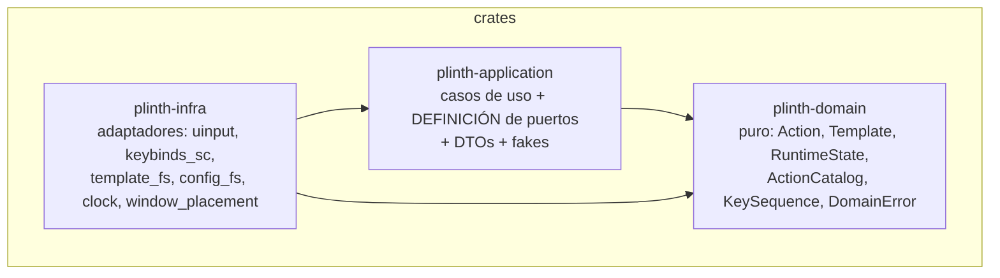

# Plan — Plinth: núcleo hexagonal (workspace + domain + application + infra)

## Contexto

Plinth es **greenfield**: el repo solo contiene `docs/` (contexto, roadmap, análisis Fase 0) y
un `.gitignore` por defecto. No hay código. Este PR materializa la **arquitectura de puertos y
adaptadores** que el roadmap describe, en su parte **verificable en CI sin hardware**.

**Alcance de ESTE PR (decidido):** workspace Cargo + `plinth-domain` + `plinth-application`
(puertos + casos de uso + fakes + tests) + `plinth-infra` (`input_uinput`, `keybinds_sc`,
`template_fs`, `config_fs`, `clock`, `window_placement`). **No** se incluye la capa Tauri/React
(fase posterior) ni el spike de Fase 0 (se valida en la máquina del dev: necesita SC + Hyprland
+ pantalla táctil). El test runtime de uinput va detrás de `#[ignore]` porque requiere
`/dev/uinput`.

El objetivo de portfolio ("arquitectura limpia de sistemas") se materializa con **fronteras
verificadas por el compilador** (multi-crate: un `use evdev` en el dominio no compila) + un
**fitness test** por grep en CI.

## Por qué este recorte

Las fases 2–4 del roadmap (UI, plantillas reales, publicación) y el spike de Fase 0 son
**empíricos** o dependen del entorno del dev y no se pueden verificar en este contenedor remoto.
Lo que sí queda **completo, compilado y testeado en CI** es el corazón arquitectónico: el motor
agnóstico al juego + los dos adaptadores que cargan el peso real (`InputSender`,
`GameKeybindProvider`) + el de plantillas. Eso retira el riesgo de diseño y deja todo listo para
enchufar Tauri y correr el spike después.

## Arquitectura — dirección de dependencias y flujo de `ExecuteAction`



Flujo del caso de uso central (`ExecuteAction(component_id)`):

```
componente.action == AppAction  → muta RuntimeState (navegar/lock/sidebar). NUNCA toca input.
componente.action == GameAction → GameKeybindProvider.resolve(action) -> KeyBinding
                                   → SequenceRunner expande la KeySequence:
                                       Press : emit(down), emit(up)
                                       Hold  : emit(down), Clock.sleep(dur), emit(up)
                                       Toggle: lee/escribe RuntimeState.toggles, emit según estado
                                   → InputSender.emit(events)   NUNCA muta RuntimeState
```

**Fitness test (debe devolver vacío):**
`grep -ri "star\|p4k\|actionmap\|evdev\|tauri\|uinput" crates/plinth-domain crates/plinth-application/src`

## Ficheros a crear

```
Cargo.toml                                  # [workspace] resolver=2, members, workspace.deps
crates/plinth-domain/Cargo.toml + src/      # lib.rs, action.rs, catalog.rs, template.rs, runtime.rs, key.rs, error.rs
crates/plinth-application/Cargo.toml + src/ # lib.rs, ports.rs, dto.rs, usecases/, testing.rs (feature "testing")
crates/plinth-infra/Cargo.toml + src/       # lib.rs, input_uinput.rs, keybinds_sc.rs, template_fs.rs, config_fs.rs, clock.rs, window_placement.rs
crates/plinth-infra/tests/                  # architecture_smoke.rs + fixtures/ (template.yaml, exported.xml)
schema/plinth.template.schema.json          # contrato de plantilla, campo schema_version
docs/hyprland-rules.md                      # windowrulev2 (float/pin/monitor/size/nofocus) + r_WindowMode=1 + nota udev
packaging/99-uinput.rules                   # udev: acceso a /dev/uinput para grupo input
.github/workflows/ci.yml                    # fmt + clippy + test + fitness grep
```

## Implementación (en orden de dependencias)

### 1. Workspace raíz — `Cargo.toml`
`[workspace] resolver = "2"`, `members = [los 3 crates]`. `[workspace.package] edition = "2021"`,
`publish = false` (licencia diferida; no publicar). `[workspace.dependencies]` con `thiserror`
para reuso. No tocar `.gitignore` (ya cubre `/target/`).

### 2. `plinth-domain` (deps: `thiserror`) — puro, sin I/O
- **`action.rs`**: `Action { App(AppAction), Game(GameAction) }`. **Sin variante `Raw(String)`**
  → comando arbitrario es irrepresentable. `AppAction` enum cerrado: `NextPage`, `PrevPage`,
  `GoToPage(usize)`, `ToggleLock`, `SwitchSidebarSide`. `GameAction(ActionId)` con
  `ActionId(String)` **newtype opaco** (el dominio NO conoce IDs de SC → agnóstico).
- **`catalog.rs`**: `ActionCatalog` = conjunto de `ActionId` legales de juego. Constructor
  `from_actions(impl IntoIterator<Item=ActionId>)`. Método autoridad
  `resolve(&self, raw: &str) -> Result<Action, DomainError>`: si `raw` casa un identificador
  reservado de `AppAction` → esa variante; si está en el set de juego → `Action::Game`; si no →
  `DomainError::UnknownAction`. **El contenido específico de SC se inyecta desde infra; la
  autoridad de legalidad vive aquí.** Esto separa `UnknownAction` (no existe) de `ActionNotBound`
  (existe pero sin tecla).
- **`key.rs`**: `EvdevKeyCode(u16)` newtype; `KeyStep { code, kind: Press|Hold(Duration)|Toggle }`;
  `KeySequence(Vec<KeyStep>)` con constructor que rechaza secuencia vacía; `KeyBinding` (alias/VO
  de `KeySequence` resuelta); `SidebarSide { Left, Right }`; `SchemaVersion`; `ComponentPosition`;
  `VisualProps`.
- **`template.rs`**: `Template` (raíz de agregado, inmutable) con `metadata` (game, version, author,
  schema_version), `Vec<Page>`, `Sidebar`. `Page { components: Vec<Component> }`. `Component { id,
  position, visual, action: Action }`. `Sidebar { side, components }`. Constructores `TryFrom`/`new`
  que validan invariantes (sin páginas vacías, IDs de componente únicos, referencias de `GoToPage`
  dentro de rango) → un `Template` inválido es inconstruible.
- **`runtime.rs`**: `RuntimeState` (**única entidad mutable**): `current_page`, `lock: bool`,
  `toggles: HashMap<ComponentId,bool>`. Métodos: `navigate(dir, page_count)` y `go_to(idx,
  page_count)` que devuelven `Err(LockEngaged)` si lock activo y `Err(PageOutOfRange)` si fuera de
  rango; `toggle_lock`, `switch_sidebar`.
- **`error.rs`**: `DomainError` (thiserror): `UnknownAction(String)`, `ActionNotBound(ActionId)`,
  `PageOutOfRange{requested,max}`, `LockEngaged`, `EmptyTemplate`, `DuplicateComponentId(String)`,
  `EmptyKeySequence`, `UnknownComponent(String)`.
- **Tests** (`cargo test -p plinth-domain`, sin mocks): catálogo (resolve→Unknown/App/Game),
  lock bloquea navegación, límites de página, unicidad de IDs, secuencia vacía rechazada.

### 3. `plinth-application` (deps: `plinth-domain`) — casos de uso + puertos
- **`ports.rs`** (traits sync; el consumidor define la interfaz):
  - `InputSender::emit(&self, events: &[KeyEvent]) -> Result<(), InputError>` con
    `KeyEvent { code: EvdevKeyCode, value: Down|Up }`. **Refinamiento del draft:** el puerto es de
    bajo nivel (`emit` de eventos), no `send(KeySequence)`, para que el *timing* (holds) lo orqueste
    un `SequenceRunner` de aplicación usando `Clock` → testeable con `FakeClock`.
  - `GameKeybindProvider`: `resolve(&self, &GameAction) -> Result<KeyBinding, ResolveError>`
    (`ResolveError::NotBound`→`ActionNotBound`), `refresh(&self) -> Result<(), ProviderError>`,
    `catalog(&self) -> ActionCatalog` (alimenta el catálogo del dominio en el composition root).
  - `TemplateSource::load(&self, reference: &str) -> Result<Template, TemplateError>`.
    **Refinamiento del draft:** devuelve `Template` (dominio) ya validado; el `RawTemplateDoc`/serde
    queda **interno a infra** (no fuga serde a application). Los 3 checks siguen en sus 3 sitios:
    forma (schema) en el loader/infra, pertenencia (catálogo) en el mapper/infra **consultando
    `ActionCatalog` del dominio**, invariantes en los constructores del dominio.
  - `Clock::sleep(&self, Duration)`.
  - `ConfigStore`: `load(&self) -> Result<Prefs, ...>`, `save(&self, &Prefs) -> Result<(), ...>`
    (`Prefs { sidebar_side, last_template }`).
  - `WindowPlacement::place(&self, ...) -> Result<(), ...>` — *seam* (no-op en Linux).
- **`usecases/`**: structs que toman los puertos por genéricos/`&dyn` y exponen un método:
  `LoadTemplate`, `QueryRenderState`, `ExecuteAction`, `Navigate`/`GoToPage`, `ToggleLock`,
  `SwitchSidebarSide`, `RefreshKeybinds`. `ExecuteAction` implementa el flujo del diagrama; incluye
  el `SequenceRunner` (expande `KeySequence`→`KeyEvent`s intercalando `Clock.sleep` en los `Hold`).
- **`dto.rs`**: `RenderState` (páginas, página actual, lado sidebar, estado lock, por componente:
  visual + estado toggle/enabled). **NO expone `EvdevKeyCode`/`KEY_` resueltos ni internals.**
- **`testing.rs`** (tras feature `testing`, reusable por infra/tests): `FakeInputSender` (graba los
  `KeyEvent` emitidos), `FakeKeybindProvider` (tabla canned + catálogo), `FakeClock` (registra
  `sleep` sin esperar), `InMemoryTemplateSource`, `InMemoryConfigStore`, `NoopWindowPlacement`.
- **Tests** (`cargo test -p plinth-application --features testing`, sin uinput/SC/root → CI):
  botón de juego produce **exactamente** la secuencia esperada en `FakeInputSender`; `Hold` produce
  `down → FakeClock.sleep(dur) → up`; `Toggle` voltea `RuntimeState` y emite según estado; ruta
  `ActionNotBound`; **botón de app deja `FakeInputSender` vacío** (separación por tipo); navegar con
  lock → `LockEngaged`; `GoToPage` fuera de rango → `PageOutOfRange`; **test de omisión del DTO**:
  assert estructural de que `RenderState` no contiene códigos de tecla.

### 4. `plinth-infra` (deps: `application`, `domain` + crates externos)
Resolver versiones con `cargo add` en la máquina del dev (crates.io bloqueado en este contenedor).
Crates: `evdev`, `serde`/`serde_json`, un YAML mantenido (`serde_yaml_ng` o `serde_yml`; el
`serde_yaml` original está archivado), `jsonschema`, `quick-xml` (feature serde) o `serde-xml-rs`,
`dirs`, `thiserror`.
- **`input_uinput.rs`**: implementa `InputSender`. Construye `VirtualDevice` declarando el set
  completo de teclas que puede emitir; en `emit` traduce `EvdevKeyCode`→`KeyCode` de evdev y emite
  `InputEvent`s `EV_KEY` + `EV_SYN`. *(API conceptual: `VirtualDevice::builder()?.name(..)
  .with_keys(&AttributeSet<KeyCode>)?.build()?` y `dev.emit(&[InputEvent::new(EventType::KEY, code,
  value)])`; ajustar a la versión que resuelva `cargo add evdev`.)* Test runtime `#[ignore]` (crea
  device real, emite `KEY_A`; requiere `/dev/uinput`).
- **`keybinds_sc.rs`**: **único** módulo que nombra SC. Parsea el XML exportado
  (`pp_rebindkeys export all <name>` → `layout_<name>_exported.xml`) y/o `actionmaps.xml`
  (overrides del usuario). Construye `(ActionCatalog, mapa GameAction→KeyBinding)`; implementa
  `GameKeybindProvider`. Incluye tabla de tokens SC→`EvdevKeyCode` (p. ej. `"a"→KEY_A`,
  `"lshift"→KEY_LEFTSHIFT`, `"np_1"→KEY_KP1`). `Data.p4k` (defaults binarios) queda **fuera de
  alcance** (parte del export en texto plano). Test con fixture XML.
- **`template_fs.rs`**: lee YAML → `serde_json::Value` → valida contra
  `schema/plinth.template.schema.json` (`jsonschema`) con errores claros (ruta/línea) → mapea
  `Value`→`Template` consultando el `ActionCatalog` inyectado (cada string de acción pasa por
  `ActionCatalog::resolve`; desconocida → `UnknownAction`). Implementa `TemplateSource`. Test con
  fixture YAML + el schema.
- **`config_fs.rs`**: `ConfigStore` con prefs en TOML/JSON bajo dir XDG (`dirs`).
- **`clock.rs`**: `Clock` real (`std::thread::sleep`).
- **`window_placement.rs`**: `WindowPlacement` no-op en Linux; doc-comment apunta a
  `docs/hyprland-rules.md`.
- **Test de integración `tests/architecture_smoke.rs`** (CI-safe, análogo al "slice vertical" del
  draft sin hardware): carga `fixtures/template.yaml` vía `template_fs` + `fixtures/exported.xml`
  vía `keybinds_sc` + `FakeInputSender` + `FakeClock` + `ExecuteAction` real → assert de que tocar
  el botón emite los `KeyEvent` que corresponden al keybind del fixture. Ejercita todas las capas y
  los dos puertos pesados salvo el device físico.

### 5. Ficheros no-crate
- **`schema/plinth.template.schema.json`**: JSON Schema versionado (`schema_version`, `metadata`
  {game,version,author}, `pages[].components[]` {id, type, position, visual, action{kind:game|app,
  id}}, `sidebar`{side, components}). Contrato/fuente de verdad.
- **`docs/hyprland-rules.md`**: `windowrulev2` (`float`, `pin`, `monitor`, `size`, `nofocus`) +
  `USER.cfg` `r_WindowMode = 1` + nota de la regla udev. (Validado empíricamente en Fase 0, fuera
  de este PR.)
- **`packaging/99-uinput.rules`**: udev que da acceso a `/dev/uinput` al grupo `input`.
- **`.github/workflows/ci.yml`**: `cargo fmt --check`, `cargo clippy -D warnings`, `cargo test
  --workspace --features testing` (excluye `#[ignore]`), y el **fitness grep** como paso que falla
  si encuentra coincidencias.

## Verificación

- `cargo build --workspace` compila; las fronteras las garantiza el grafo de deps del workspace.
- `cargo test -p plinth-domain` — invariantes puros, sin mocks.
- `cargo test -p plinth-application --features testing` — `ExecuteAction` (secuencia exacta, holds
  con `FakeClock`, toggles), `ActionNotBound`, botón de app no emite, lock bloquea navegación,
  rango de página, **omisión del DTO**. Sin uinput/SC/root.
- `cargo test -p plinth-infra` — parseo SC (fixture XML), loader+schema+mapper (fixture YAML),
  `architecture_smoke` end-to-end con fakes.
- `cargo test -p plinth-infra -- --ignored` — **solo en la máquina del dev**: crea `VirtualDevice`,
  emite `KEY_A`, verifica con `evdev`/`wev`/`evtest`.
- **Fitness test:** el grep de la sección de arquitectura devuelve vacío (también en CI).
- `cargo fmt --check` y `cargo clippy --workspace -- -D warnings` limpios.

## Riesgos / tradeoffs

- **Sobre-ingeniería (un solo dev):** mitigado — solo 2 puertos pesan (`InputSender`,
  `GameKeybindProvider`); `WindowPlacement` es seam no-op; `ConfigStore` es colapsable.
- **Crates no verificables aquí** (crates.io/docs.rs bloqueados): el API de `evdev`/YAML se fija con
  `cargo add` en la máquina del dev; el plan da el camino conceptual y deja la versión exacta a la
  resolución local.
- **`serde_yaml` archivado:** usar fork mantenido (`serde_yaml_ng`/`serde_yml`); decisión documentada.
- **Esto NO de-riesga R1 (foco):** es empírico y vive fuera de Rust (Hyprland). El spike de Fase 0 y
  el test crítico de foco quedan para la máquina del dev; no sustituir correrlos por el pulido
  arquitectónico.
- **`keybinds_sc`:** parte del XML exportado (texto plano); el cracking de `Data.p4k` para defaults
  queda como mejora posterior.

Sources: [RSI KB — Create/export/import profiles](https://support.robertsspaceindustries.com/hc/en-us/articles/360000183328-Create-export-and-import-custom-profiles)
